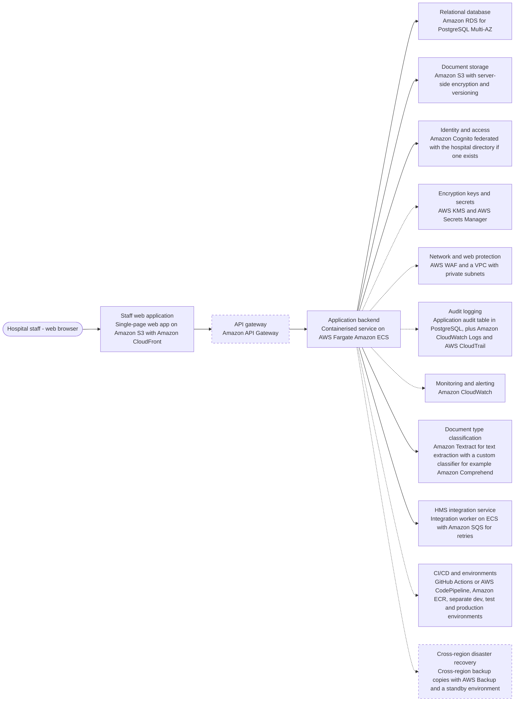

# Technical Proposal Draft: Patient Record Management Modernization Programme

> **DRAFT - AI-generated. Requires human solution-architect review. Not a quotation or contractual commitment.**  
> Generated on 2026-11-24. Source of analysis: Mixed - some sections use built-in DEMO sample data.

## 1. Project overview

- **Project:** Patient Record Management Modernization Programme
- **Client industry:** Healthcare
- **Project type(s):** Web application development, Enterprise software integration, AI/ML implementation, Business process automation
- **Target users:** doctors, nurses, front-desk and reception staff, medical records staff, hospital administrators
- **Cloud preference stated:** Cloud-hosted web application
- **Timeline stated:** First release to go live approximately nine months after contract signing, with a phased rollout across the three hospitals
- **Budget stated:** Not specified

## 2. Customer business problem

Patient records are currently managed through a mix of paper files, shared network folders and spreadsheets, which are held separately at each site. Staff spend significant time searching for records, patient documents are often duplicated or misfiled, and there is no consistent record of who has viewed or changed a patient file.

**Business objectives**

- Replace fragmented paper and spreadsheet records with a single, secure digital patient-record workflow.
- Reduce the time clinical and administrative staff spend locating and filing patient documents.
- Improve traceability by recording who accessed or changed patient information.
- Reduce missed and double-booked appointments.

## 3. Proposed solution

This draft addresses 16 requirements extracted from the customer document (12 of high priority). Core capabilities:

- The system shall provide a secure web application accessible from standard desktop browsers inside the hospitals.
- The system shall allow authorised staff to create, view, update and archive patient records.
- The system shall allow staff to upload scanned and digital patient documents and attach them to a patient record.
- The system shall provide appointment management, including booking, rescheduling, cancelling and viewing a doctor's daily schedule.
- The system shall integrate with the hospital's existing Hospital Management System (HMS) through its API so that patient demographic details and appointment information stay consistent.
- The system shall include an AI-assisted feature that suggests a document type for each uploaded patient document, which a staff member must confirm or correct.

The recommended design uses managed AWS services (see sections 5 and 6).

## 4. Requirements summary

| ID | Requirement | Category | Priority | Missing information |
|---|---|---|---|---|
| REQ-001 | The system shall provide a secure web application accessible from standard desktop browsers inside the hospitals. | Functional | High | Specific browser versions and allowed network ranges/IPs. |
| REQ-002 | The system shall allow authorised staff to create, view, update and archive patient records. | Functional | High | Specific data fields required within patient records and archiving retention rules. |
| REQ-003 | The system shall enforce role-based access control so that doctors, nurses, front-desk staff, records staff and administrators see only the information their role permits. | Security | High | Detailed permission matrix per role. |
| REQ-004 | The system shall allow staff to upload scanned and digital patient documents and attach them to a patient record. | Functional | High | Supported file formats, maximum file size limits, and storage volumes. |
| REQ-005 | The system shall maintain an audit log that records who viewed, created, changed or downloaded patient information, and when. | Security | High | Audit log retention period and export/reporting format requirements. |
| REQ-006 | The system shall provide appointment management, including booking, rescheduling, cancelling and viewing a doctor's daily schedule. | Functional | High | Specific scheduling rules, notification methods, and calendar sync requirements. |
| REQ-007 | The system shall integrate with the hospital's existing Hospital Management System (HMS) through its API so that patient demographic details and appointment information stay consistent. | Integration | High | HMS API documentation, endpoints, rate limits, and authentication protocols. |
| REQ-008 | The system shall include an AI-assisted feature that suggests a document type for each uploaded patient document, which a staff member must confirm or correct. | AI/ML | Medium | Target accuracy thresholds and accepted AI model hosting constraints. |
| REQ-009 | Patient information must be stored securely, with encryption of data at rest and in transit. | Security | High | Specific cryptographic standards or key management requirements (e.g., AES-256, TLS 1.3). |
| REQ-010 | The solution must be hosted in the cloud and must scale to support growth across additional sites in the future. | Scalability | High | Preferred cloud provider (AWS, Azure, GCP) and expected user concurrency numbers. |
| REQ-011 | The system must be highly available during hospital working hours, as clinical staff depend on it. | Availability | High | Specific uptime percentage (e.g., 99.9%) and RPO/RTO metrics. |
| REQ-012 | Search and record retrieval should feel fast for staff during busy periods. | Performance | Medium | Quantitative latency targets (e.g., search results under 2 seconds). |
| REQ-013 | The user interface must be simple enough for staff with limited technical training. | Non-functional | Medium | Accessibility standards (e.g., WCAG 2.1 AA) or UI/UX design system preferences. |
| REQ-014 | Access to the system must require authenticated user accounts. | Security | High | Authentication mechanism (e.g., SSO, LDAP, MFA requirements). |
| REQ-015 | The solution must handle patient data in line with applicable data protection law, including India's Digital Personal Data Protection Act, 2023. | Compliance | High | Specific data localization or consent management workflows required by the Act. |
| REQ-016 | The vendor must describe how any additional healthcare-specific regulatory requirements will be identified and met. | Compliance | Medium | List of any other known regulatory bodies or standards. |

## 5. Recommended architecture

**Cloud provider (assumption):** AWS

**Architecture assumptions**

- The RFP names no cloud provider. AWS was selected for this draft; generate Azure to compare.
- Hosting in an India region is assumed because the RFP cites India's DPDP Act. Data residency must be confirmed.
- Staff reach the application over the hospital network or a VPN. The access model is unconfirmed.
- Concurrent users are unknown, so the design uses managed services that can scale and includes no sizing.
- PostgreSQL is assumed as the database engine because no existing database is described.

| Layer | Component | Suggested service | Status | Requirements | Why |
|---|---|---|---|---|---|
| Frontend | Staff web application | Single-page web app on Amazon S3 with Amazon CloudFront | Recommended | REQ-001, REQ-013 | REQ-001 and REQ-013 need a simple, secure web application; static hosting behind a CDN is low-maintenance and HTTPS-only. |
| Backend | Application backend | Containerised service on AWS Fargate (Amazon ECS) | Recommended | REQ-002, REQ-003, REQ-006 | Covers REQ-002, REQ-003 and REQ-006. Managed containers avoid server administration, which suits a three-person hospital IT team (REQ-017). |
| API layer | API gateway | Amazon API Gateway | Optional | REQ-003, REQ-014 | Helpful for central access control and rate limiting, but the requirements do not demand it. A load balancer may be enough. |
| Database | Relational database | Amazon RDS for PostgreSQL (Multi-AZ) | Recommended | REQ-002, REQ-006, REQ-011 | Patient and appointment data is structured and relational (REQ-002, REQ-006). Managed high availability supports REQ-011. |
| File storage | Document storage | Amazon S3 with server-side encryption and versioning | Recommended | REQ-004, REQ-009 | REQ-004 requires document uploads. Object storage is the standard fit and supports encryption at rest (REQ-009). |
| Authentication | Identity and access | Amazon Cognito (federated with the hospital directory if one exists) | Recommended | REQ-003, REQ-014 | REQ-014 requires authenticated users and REQ-003 requires role-based access. |
| Security | Encryption keys and secrets | AWS KMS and AWS Secrets Manager | Recommended | REQ-009 | REQ-009 requires encryption at rest and in transit. Central key management keeps secrets out of code. |
| Security | Network and web protection | AWS WAF and a VPC with private subnets | Recommended | REQ-009, REQ-015 | Patient data is sensitive (REQ-009, REQ-015). Private data stores reduce exposure. |
| Logging | Audit logging | Application audit table in PostgreSQL, plus Amazon CloudWatch Logs and AWS CloudTrail | Recommended | REQ-005 | REQ-005 requires an audit log. User-level events must be written by the application; cloud logs cover infrastructure activity. |
| Monitoring | Monitoring and alerting | Amazon CloudWatch | Recommended | REQ-011, REQ-012 | Supports REQ-011 (availability) and REQ-012 (responsiveness). |
| AI/ML | Document type classification | Amazon Textract for text extraction with a custom classifier (for example Amazon Comprehend) | Recommended | REQ-008 | REQ-008 asks for AI-assisted document type suggestions. Managed services avoid building and hosting a custom model. |
| Integration | HMS integration service | Integration worker on ECS with Amazon SQS for retries | Recommended | REQ-007 | REQ-007 requires HMS integration. A queue-backed worker tolerates HMS downtime and retries failed calls. |
| Deployment | CI/CD and environments | GitHub Actions or AWS CodePipeline, Amazon ECR, separate dev, test and production environments | Recommended | - | Supports user acceptance testing (REQ-017) and the phased rollout in REQ-019. |
| Resilience | Cross-region disaster recovery | Cross-region backup copies with AWS Backup and a standby environment | Optional | REQ-011 | Only worth adding if the (unknown) RTO/RPO targets or the business require it. |

_Recommended = justified by the requirements. Optional = useful but not required by them._

**How the components communicate**

Staff open the web application in a browser over HTTPS and sign in through the identity service. The frontend calls the backend API, optionally through an API gateway. The backend reads and writes patient and appointment data in the relational database, stores uploaded documents in object storage and writes audit events. After an upload, the backend asks the AI service for a document type suggestion and shows it for staff to confirm. A queue-backed integration service exchanges data with the HMS API. Monitoring and logging collect telemetry from all components.

**Key trade-offs**

- Managed services reduce operations effort for a small hospital IT team but create provider lock-in and ongoing service costs.
- One relational database keeps patient, appointment and audit data consistent; heavy document search may later need a separate search service.
- Managed AI classification is faster than a custom model but gives less control over accuracy and needs a decision on how patient data is handled.
- An API gateway improves central control but adds cost and complexity, so it is marked optional.
- Multi-zone high availability is recommended; cross-region disaster recovery stays optional until RTO/RPO and residency rules are known.

**Security considerations**

- Encrypt data at rest and in transit using managed keys (REQ-009).
- Keep the database and storage on private networks and expose only the web entry point.
- Enforce role-based access in the backend, not only in the user interface (REQ-003).
- Write user-level audit events for every view, change and download (REQ-005).
- Confirm data residency and processing rules under the DPDP Act, 2023 before choosing regions and the AI service (REQ-015).
- Use least-privilege service roles and keep secrets in a managed vault.

**Scalability considerations**

- Run the backend as stateless containers so instances can be added as load grows (REQ-010).
- Serve the frontend from a CDN so web traffic does not load the backend.
- Grow the database with larger instances or read replicas; sizing needs the concurrent user count.
- Add new hospital sites as configuration of the same deployment rather than separate copies.

_No cloud cost estimate is given: costs need workload data and current provider pricing._

## 6. Architecture diagram

_Paste the code above into https://mermaid.live to view the diagram. Dashed boxes are optional._

## 7. Implementation approach

- **Phase 1: Discovery and requirement finalization** - Conduct requirement workshops with hospital staff; Finalize workflows for patient records, appointments, and role-based access (REQ-002, REQ-003, REQ-006)
- **Phase 2: Architecture and technical design** - Design cloud-hosted web application architecture supporting future multi-site scaling (REQ-001, REQ-010); Plan database development for patient records, appointments, and audit logs (REQ-002, REQ-005, REQ-006)
- **Phase 3: MVP development** - Develop core backend services and database for patient record CRUD and archiving (REQ-002); Implement appointment management booking, rescheduling, cancelling, and daily schedule views (REQ-006)
- **Phase 4: Integrations and advanced functionality** - Build integration with the Hospital Management System (HMS) API for demographic and appointment consistency (REQ-007); Implement document upload functionality for scanned and digital files attached to patient records (REQ-004)
- **Phase 5: Testing and security validation** - Perform testing and quality assurance across all modules including search, record retrieval, and high availability scenarios (REQ-011, REQ-012); Validate encryption at rest and in transit, and security controls (REQ-009)
- **Phase 6: Deployment and handover** - Deploy cloud-hosted web application into production for the initial release; Execute phased rollout across the three hospitals

Phases overlap logically as backend design and early frontend work can run in parallel once discovery yields sufficient detail. The nine-month timeline mentioned in the requirements cannot be strictly confirmed without knowing the exact team size, developer availability, and the speed of HMS vendor cooperation. Warning: the roadmap text contains what looks like a calendar date. Dates cannot be promised without a team size and working calendar.

## 8. Work breakdown structure

- **Discovery and planning** (Business Analyst / Solution Architect)
  - Requirement workshops with stakeholders
  - Resolve open clarification questions
  - Backlog and delivery plan
- **UI/UX design** (UI/UX Designer)
  - User flows and wireframes
  - Visual design and component library
  - Usability review with staff
- **Frontend development** (Frontend Developer)
  - Build screens for each user role
  - Connect screens to backend APIs
  - Accessibility and browser checks
- **Backend development** (Backend Developer)
  - Business logic and services
  - Authentication and role-based access
  - Audit and error handling
- **Database development** (Database Engineer / Backend Developer)
  - Data model and migrations
  - Indexes and query tuning
  - Backup and retention configuration
- **API and integrations** (Integration Engineer)
  - Design the application API
  - Build and test each external integration
  - Error handling and retry logic
- **AI/ML implementation** (ML Engineer)
  - Select and configure the AI service or model
  - Prepare evaluation data
  - Measure accuracy and tune
  - Human review workflow
- **Testing and QA** (QA Engineer)
  - Test plan and automated tests
  - Security and role-permission testing
  - User acceptance testing support
- **Deployment** (DevOps Engineer)
  - Environment setup
  - CI/CD pipeline
  - Monitoring and alerting
  - Production release
- **Documentation and handover** (Technical Writer / Project Manager)
  - User and admin guides
  - Technical documentation
  - Training session and handover

## 9. Preliminary effort estimate

| Phase | Role | Min person-days | Max person-days |
|---|---|---|---|
| Discovery and planning | Business Analyst / Solution Architect | 8 | 14 |
| UI/UX design | UI/UX Designer | 10 | 17 |
| Frontend development | Frontend Developer | 25 | 40 |
| Backend development | Backend Developer | 35 | 60 |
| Database development | Database Engineer / Backend Developer | 9 | 15 |
| API and integrations | Integration Engineer | 15 | 30 |
| AI/ML implementation | ML Engineer | 20 | 35 |
| Testing and QA | QA Engineer | 21 | 54 |
| Deployment | DevOps Engineer | 12 | 21 |
| Documentation and handover | Technical Writer / Project Manager | 5 | 9 |

- Subtotal: 160 - 295 person-days
- Suggested contingency: 20% (32 - 59 person-days)
- **Overall estimated range (with contingency): 192 - 354 person-days**

**How the estimate was calculated**

- Project size 'Medium': scope-driven phases (discovery, design, frontend, backend, database, documentation) are multiplied by 1.0.
- High security level: backend x1.15, database x1.10, deployment +4 to +6 person-days.
- 1 external integration(s): +10 to +18 person-days each on top of the base API work.
- AI complexity 'Medium': AI/ML phase set to 20 to 30 person-days.
- Testing and QA = 20% (minimum) to 30% (maximum) of development effort (frontend, backend, database, integrations, AI/ML).
- Requirement clarity 'Partial': every phase minimum x1.0 and maximum x1.15 (unclear requirements widen the range).
- Contingency 20%: base by clarity (15%), +5% for medium/high AI, +5% for 3 or more integrations, capped at 30%.

_Preliminary estimate for discussion only. It is not a quotation and not a fixed price. The baseline values are generic assumptions and are not calibrated against any company's historical delivery data. Effort is in person-days, not calendar time. Duration depends on team size, working calendar and scope. A solution architect must review the inputs, rules and results before use._

## 10. Team roles

| Role | Phases | Min person-days | Max person-days |
|---|---|---|---|
| Business Analyst / Solution Architect | Discovery and planning | 8 | 14 |
| UI/UX Designer | UI/UX design | 10 | 17 |
| Frontend Developer | Frontend development | 25 | 40 |
| Backend Developer | Backend development | 35 | 60 |
| Database Engineer / Backend Developer | Database development | 9 | 15 |
| Integration Engineer | API and integrations | 15 | 30 |
| ML Engineer | AI/ML implementation | 20 | 35 |
| QA Engineer | Testing and QA | 21 | 54 |
| DevOps Engineer | Deployment | 12 | 21 |
| Technical Writer / Project Manager | Documentation and handover | 5 | 9 |

## 11. Technical roadmap

### Phase 1: Discovery and requirement finalization

**Estimated duration:** 2-3 weeks depends on team size

**Activities**

- Conduct requirement workshops with hospital staff
- Finalize workflows for patient records, appointments, and role-based access (REQ-002, REQ-003, REQ-006)
- Review data protection and compliance obligations under India's Digital Personal Data Protection Act, 2023 (REQ-015)
- Coordinate with the HMS vendor for API access and documentation (REQ-007)

**Deliverables**

- Finalized requirement specification document
- Role-based access control permission matrix
- HMS API integration plan

**Dependencies**

- Hospital staff availability for workshops
- HMS vendor cooperation

**Completion criteria**

- Requirements are signed off by project stakeholders
- Compliance approach for DPDP Act 2023 is documented

### Phase 2: Architecture and technical design

**Estimated duration:** 3-4 weeks depends on team size

**Activities**

- Design cloud-hosted web application architecture supporting future multi-site scaling (REQ-001, REQ-010)
- Plan database development for patient records, appointments, and audit logs (REQ-002, REQ-005, REQ-006)
- Design security architecture including encryption at rest and in transit, and authentication mechanisms (REQ-009, REQ-014)
- Create simple UI/UX wireframes for staff with limited technical training (REQ-013)

**Deliverables**

- System architecture diagram
- Database schema design
- UI/UX wireframes and design system

**Dependencies**

- Phase 1 completion

**Completion criteria**

- Architecture and security designs are reviewed and approved
- UI/UX wireframes validated against target user needs

### Phase 3: MVP development

**Estimated duration:** 8-12 weeks depends on team size

**Activities**

- Develop core backend services and database for patient record CRUD and archiving (REQ-002)
- Implement appointment management booking, rescheduling, cancelling, and daily schedule views (REQ-006)
- Develop frontend web application accessible via desktop browsers (REQ-001)
- Implement secure user authentication and role-based access control (REQ-003, REQ-014)

**Deliverables**

- Core backend API services
- Database implementation
- Frontend web application MVP

**Dependencies**

- Phase 2 completion

**Completion criteria**

- MVP code successfully deployed to development environment
- Core patient record and appointment flows operational

### Phase 4: Integrations and advanced functionality

**Estimated duration:** 4-7 weeks depends on team size

**Activities**

- Build integration with the Hospital Management System (HMS) API for demographic and appointment consistency (REQ-007)
- Implement document upload functionality for scanned and digital files attached to patient records (REQ-004)
- Develop AI-assisted document type suggestion feature with staff confirmation workflow (REQ-008)
- Implement comprehensive audit logging for viewing, creating, changing, and downloading patient information (REQ-005)

**Deliverables**

- HMS API integration module
- Document upload and AI classification module
- Audit logging system

**Dependencies**

- Phase 3 completion
- HMS API availability

**Completion criteria**

- Successful data synchronization with HMS via API
- AI document type suggestions functioning with staff confirmation UI
- Audit logs capturing all required user actions

### Phase 5: Testing and security validation

**Estimated duration:** 5-10 weeks depends on team size

**Activities**

- Perform testing and quality assurance across all modules including search, record retrieval, and high availability scenarios (REQ-011, REQ-012)
- Validate encryption at rest and in transit, and security controls (REQ-009)
- Conduct User Acceptance Testing (UAT) with hospital staff and hospital IT team support
- Verify compliance controls and role-based access restrictions (REQ-003, REQ-015)

**Deliverables**

- Testing and QA report
- Security validation report
- UAT sign-off documentation

**Dependencies**

- Phase 4 completion
- Hospital staff and IT team availability

**Completion criteria**

- All high-priority bugs resolved
- UAT signed off by hospital staff
- Security validation confirms encryption and access controls

### Phase 6: Deployment and handover

**Estimated duration:** 3-5 weeks depends on team size

**Activities**

- Deploy cloud-hosted web application into production for the initial release
- Execute phased rollout across the three hospitals
- Handover documentation and conduct training for clinical and administrative staff
- Provide initial post-launch support and transition to hospital IT team maintenance

**Deliverables**

- Production-ready cloud deployment
- System documentation and handover materials
- Staff training records

**Dependencies**

- Phase 5 completion

**Completion criteria**

- System successfully deployed to production
- Initial release live across target sites
- Handover completed with hospital staff and IT team

_Durations are indicative. No delivery dates are promised without a team size, working calendar and agreed scope._

## 12. Assumptions

### Confirmed facts (stated in the customer document)

- Patient records are currently managed through a mix of paper files, shared network folders, and spreadsheets held separately at each site (Background).
- Migration of historical paper records is outside the scope of this project; only newly created documents are in scope (Constraints).
- The hospital IT team has three staff members and can support testing but not development (Constraints).
- The project first release is targeted to go live approximately nine months after contract signing, with a phased rollout across three hospitals (Timeline information).
- The system shall enforce role-based access control for doctors, nurses, front-desk staff, records staff, and administrators (REQ-003).
- The system shall integrate with the hospital's existing Hospital Management System (HMS) through its API (REQ-007).
- The system shall include an AI-assisted feature that suggests a document type for each uploaded patient document, which staff must confirm or correct (REQ-008).
- The solution must handle patient data in line with India's Digital Personal Data Protection Act, 2023 (REQ-015).

### Assumptions (made by this draft, not stated by the customer)

- The three hospital sites have reliable internet connectivity sufficient to support a cloud-hosted web application during working hours.
- Hospital staff will be allocated adequate time away from clinical duties to participate in requirement workshops and user acceptance testing.
- The HMS vendor has an active, documented API available for integration purposes.

### Unknowns (information still missing)

- Expected number of concurrent users and usage volume
- Preferred or mandated cloud provider (AWS, Azure, GCP)
- Existing database or data model details
- Data retention requirements and archive duration
- Recovery objectives (RTO/RPO), backup, and disaster recovery procedures
- Specific authentication mechanism (e.g., SSO, LDAP, MFA)
- Data residency and specific hosting location constraints
- Technical specifications of the HMS integration API (endpoints, rate limits, authentication protocols)
- Supported file types, maximum file size limits, and expected document upload volumes
- Budget range and funding constraints
- Not stated in the document: Expected number of concurrent users / usage volume
- Not stated in the document: Preferred or mandated cloud provider
- Not stated in the document: Existing database or data model details
- Not stated in the document: Data retention requirements
- Not stated in the document: Recovery objectives (RTO/RPO), backup and disaster recovery
- Not stated in the document: Authentication mechanism (SSO, MFA, directory)
- Not stated in the document: Data residency / hosting location constraints
- Not stated in the document: Technical specification of the integration API
- Not stated in the document: File types, size limits or document volumes
- Not stated in the document: Budget range or funding constraints

### Architecture assumptions

- The RFP names no cloud provider. AWS was selected for this draft; generate Azure to compare.
- Hosting in an India region is assumed because the RFP cites India's DPDP Act. Data residency must be confirmed.
- Staff reach the application over the hospital network or a VPN. The access model is unconfirmed.
- Concurrent users are unknown, so the design uses managed services that can scale and includes no sizing.
- PostgreSQL is assumed as the database engine because no existing database is described.

## 13. Risks

| ID | Severity | Risk | Potential impact | Suggested mitigation | Related requirement |
|---|---|---|---|---|---|
| RISK-001 | High | Dependency on the third-party Hospital Management System (HMS) vendor for API access and cooperation introduces schedule and integration risks. | Integration delays or failure to keep patient demographic and appointment details consistent could stall the project. | Establish a formal integration agreement and obtain HMS API documentation and a test environment sandbox during the initial discovery phase. | REQ-007 |
| RISK-002 | High | Compliance uncertainty regarding specific data localization, consent management workflows, and technical controls required by India's Digital Personal Data Protection Act, 2023. | Non-compliance with national data protection laws could result in legal liabilities and project rejection. | Conduct a legal and technical compliance gap analysis against the Digital Personal Data Protection Act, 2023 early in the design phase. | REQ-015, REQ-016 |
| RISK-003 | High | Limited availability of the hospital IT team (only three staff members) for development support. | The burden of testing and deployment falls heavily on the vendor, or local coordination bottlenecks occur. | Clearly scope the hospital IT team's responsibilities exclusively to testing support and provide comprehensive training packages. | Not specified |
| RISK-004 | Medium | Unclear AI model accuracy thresholds and document classification expectations for uploaded patient documents. | Low AI accuracy could lead to staff frustration if corrections are too frequent, reducing expected productivity gains. | Define acceptable initial accuracy metrics with stakeholders and plan for a feedback loop to retrain the model using staff corrections. | REQ-008 |
| RISK-005 | Medium | Lack of quantitative performance and availability metrics (e.g., precise uptime percentages and search latency targets). | Disagreements during user acceptance testing regarding whether the system 'feels fast' or is 'highly available'. | Establish Service Level Agreements (SLAs) with quantifiable targets for search retrieval times and system uptime during working hours. | REQ-011, REQ-012 |
| RISK-006 | Medium | Cloud cost and scalability uncertainty due to undefined concurrent user volumes and lack of a preferred cloud provider. | Unexpected cloud infrastructure expenses or performance degradation when scaling across additional sites. | Perform cloud sizing and capacity estimation exercises based on peak hospital working hours and projected site growth. | REQ-010 |
| RISK-007 | Medium | Unspecified authentication mechanisms (such as SSO, MFA, or directory integration) and detailed permission matrices. | Rework of the access control module if enterprise security standards are enforced late in the development cycle. | Define and sign off on the role-based permission matrix and authentication protocol requirements during the design phase. | REQ-003, REQ-014 |

## 14. Exclusions

**Stated in the customer document**

_Not specified_

**Standard exclusions proposed by this draft (assumed)**

- A fixed price, contractual quotation or delivery commitment.
- Cloud hosting, licence and third-party service charges (these need workload data and current provider pricing).
- Hardware and end-user devices.
- Migration of existing data, unless stated in the customer document.
- Post go-live support and maintenance, unless agreed separately.
- Third-party penetration testing and formal compliance certification, unless agreed separately.
- Changes to systems owned by other vendors (for example the existing HMS).

## 15. Open clarification questions

1. **[High]** What is the expected number of concurrent users and peak usage volume across the three hospital sites?  
   _Why it matters:_ Missing expected number of concurrent users / usage volume, which is necessary for sizing the cloud architecture. (related: REQ-010)
2. **[High]** Do you have a preferred or mandated cloud provider (e.g., AWS, Azure, GCP), and are there specific data residency or hosting location constraints in India?  
   _Why it matters:_ Missing preferred cloud provider and data residency constraints, which determine the target deployment environment and compliance setup. (related: REQ-010, REQ-015)
3. **[High]** Can you provide the technical documentation, endpoints, rate limits, and authentication protocols for the Hospital Management System (HMS) API?  
   _Why it matters:_ Missing technical specification of the integration API, which is critical for planning the HMS integration scope and effort. (related: REQ-007)
4. **[High]** What are the supported file formats, maximum file size limits, expected daily document volumes, and archiving retention rules for patient records?  
   _Why it matters:_ Missing file types, size limits, document volumes, and data retention requirements, which impact storage sizing and database design. (related: REQ-002, REQ-004)
5. **[High]** What are the required Recovery Time Objective (RTO) and Recovery Point Objective (RPO) metrics, backup frequencies, and high availability uptime percentages?  
   _Why it matters:_ Missing recovery objectives (RTO/RPO) and disaster recovery details, which affect the resilience and cost of the cloud infrastructure. (related: REQ-011)
6. **[Medium]** What authentication mechanism is required (e.g., Active Directory integration, Single Sign-On, Multi-Factor Authentication)?  
   _Why it matters:_ Missing authentication mechanism details, which are needed to design the identity and access management workflows. (related: REQ-014)
7. **[Medium]** Are there details available regarding the existing database schema or data model of the HMS for patient demographics?  
   _Why it matters:_ Missing existing database or data model details, which helps design clean data synchronization mappings with the HMS. (related: REQ-007)
8. **[Medium]** What is the allocated budget range or funding constraint for this project implementation and ongoing cloud operations?  
   _Why it matters:_ Missing budget range or funding constraints, which are essential for proposing an architecture that aligns with financial limits. (related: whole project)

## 16. Human review notice

This document is an AI-assisted draft. A qualified solution architect must review and correct the requirements, architecture, estimate, risks and roadmap before it is shared with a customer or used for a decision. The effort figures are preliminary, assumption-based and not calibrated against any delivery history. It is not a quotation, a fixed price or a contractual commitment.
