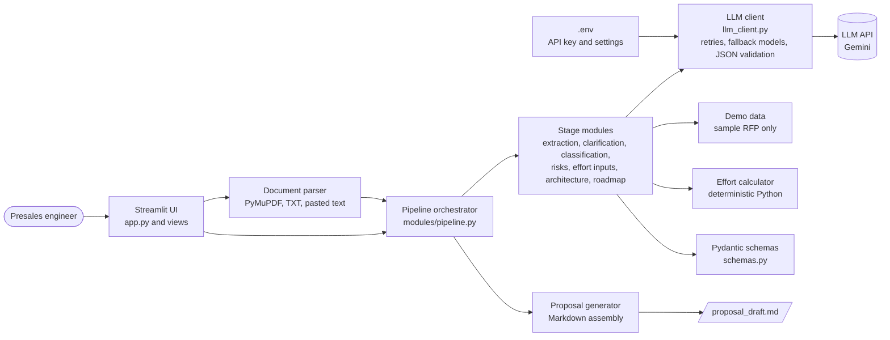
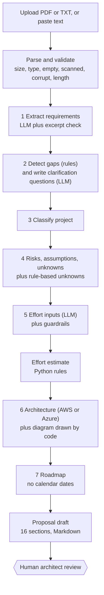

# Technical Approach Report: Cynbit Presales Copilot

**Subtitle:** An AI-powered requirements analysis, cloud architecture recommendation, effort estimation and technical roadmap generation agent
**Prepared by:** Kishan (AI/ML Engineer internship assessment)
**Date:** 25 November 2026
**Status:** Proof of concept. Everything in this report describes software that exists and was tested, except where a section says "not implemented".

> **Reading guide.** Figures in section 16 were measured by `run_evaluation.py` on the developer's machine and are copied from `reports/evaluation_results.md`. Two items are still open and are marked **[TO FILL]**: the prompt-injection result and the confirmed human architecture score. Nothing else in this report is estimated.

---

## 1. Problem definition

Technical presales teams receive customer requirements as RFPs, emails, call notes and briefs. Turning one of these into a technical proposal means reading the document, extracting requirements, finding what is missing, choosing an architecture, estimating effort, noting risks and drafting a plan. The work is repetitive, depends on who does it, and mistakes made here (a missed requirement, an unasked question) become delivery risks later.

**Goal.** Build a working assistant that converts a customer document into a structured, reviewable first draft: requirements, clarification questions, classification, cloud architecture, effort range, risks, roadmap and a proposal. **The output is always a draft for a human solution architect.** The system does not approve architectures, guarantee costs or produce binding quotations.

**Scope of this proof of concept.** One document at a time, PDF or TXT or pasted text, English, AWS and Azure as cloud options, Markdown output.

## 2. Proposed solution architecture

The system is a sequential pipeline of separate stages. There is no multi-agent framework, because the task is a fixed sequence and a plain pipeline is easier to test and explain.

**Design principles**

1. **LLM for reading and drafting, code for checking and arithmetic.** The model never produces effort totals.
2. **Every model output is validated** against a strict schema before the app uses it.
3. **Traceability.** Each requirement carries the sentence it came from, and quotes that cannot be found in the document are flagged.
4. **Honest fallbacks.** If the AI is unavailable, a clearly labeled demo mode may show built-in sample output, only for the built-in sample document.
5. **Human in the loop.** Every page and the proposal carry a draft and review notice.

### System architecture diagram



### Workflow diagram



## 3. Technology stack

| Component | Choice | Reason |
|---|---|---|
| Language | Python 3.14.6 | Developer's installed version; all libraries installed without errors |
| UI | Streamlit 1.67.0 | Fastest route to a multi-page dashboard in the time available |
| PDF text | PyMuPDF 2.1 | Fast, reliable text extraction, as recommended in the brief |
| Validation | Pydantic 2.14.4 | Typed schemas, automatic checking of model output |
| Tables | pandas 3.1.1 | Tables and filters in the UI |
| LLM API | Google Gemini via `google-genai` 3.6.1 (model `gemini-3.5-flash`, fallbacks `gemini-3.6-flash`, `gemini-3.5-flash-lite`) | Free tier available, JSON output mode, no paid tools needed |
| Configuration | python-dotenv 1.2.4 | API key kept in `.env`, excluded from version control |
| Diagrams | Mermaid (browser) and Graphviz (Streamlit) | Mermaid for the proposal; Graphviz as a backup that always renders |
| Tests | pytest 9.2.0 | Unit and end-to-end tests |
| Export | Markdown | DOCX was deferred (see section 18) |

Versions are pinned in `requirements.txt`. Not used on purpose: LangChain, vector databases and agent frameworks.

## 4. Application architecture

```
cynbit-presales-copilot/
├── app.py                      navigation and page routing
├── config.py                   settings from .env
├── schemas.py                  Pydantic models for every stage
├── llm_client.py               all model calls: retries, fallbacks, JSON validation
├── ui_common.py                shared UI helpers and session state
├── run_evaluation.py           evaluation harness
├── modules/
│   ├── document_parser.py      PDF/TXT/pasted text to clean text
│   ├── common.py               shared stage runner and demo-fallback rules
│   ├── requirement_extractor.py
│   ├── clarification_generator.py   rule-based gap detection + LLM questions
│   ├── project_classifier.py
│   ├── risk_analyzer.py
│   ├── effort_estimator.py     deterministic calculator + guardrails
│   ├── architecture_generator.py    validation + Mermaid and Graphviz drawing
│   ├── roadmap_generator.py    completeness and date checks
│   ├── proposal_generator.py   Markdown assembly
│   ├── pipeline.py             runs all stages, resumes after a failure
│   └── demo_data.py            built-in output for the sample RFP only
├── prompts/                    one prompt file per LLM stage
├── views/                      Streamlit pages
├── data/sample_rfp.txt         synthetic healthcare RFP
├── reports/                    reports and evaluation results
└── tests/                      73 unit tests
```

A **stage** has the same shape everywhere: build a prompt from a template file, call `run_stage`, validate the result, then apply a deterministic post-processing step. The shared `run_stage` function in `modules/common.py` is the single place that decides between AI output and demo fallback.

## 5. Document ingestion

Input options: upload a PDF or TXT file, paste text, or load the built-in sample. `parse_uploaded_file` rejects, with a clear message and without crashing:

- unsupported file types,
- empty files,
- files above the size limit (10 MB by default),
- corrupt or password-protected PDFs,
- PDFs with no extractable text (treated as scanned; OCR is not supported),
- pasted text that is too short.

The page shows the file name, type, page count, character count and a preview of the extracted text.

## 6. Text extraction

- **PDF:** PyMuPDF extracts text page by page. If fewer than 50 characters come out, the file is treated as scanned.
- **TXT:** decoded with UTF-8, UTF-16 or Windows-1252 fallbacks.
- **Cleaning:** normalise line endings, remove null characters, collapse repeated spaces and blank lines.
- **Long documents:** text is cut to 60,000 characters with a visible warning. Larger documents are not chunked in this MVP.

## 7. LLM integration

All model calls go through `llm_client.py`.

| Concern | How it is handled |
|---|---|
| Missing API key | Raises a clear error before any call |
| Overload or server errors (5xx) | Retries with increasing pauses, then tries the next fallback model |
| Rate limits (429) | Pause and retry |
| Bad key or bad request (400, 401, 403) | Stops immediately with the API's message, since retrying cannot help |
| Retired model (404) | Skips to the next model |
| Network problems and timeouts | Caught, retried, then next model |
| Empty or blocked response | Reported as a model output error |
| Invalid JSON | One repair retry that tells the model what was wrong, then a clear error |

These measures came from real events during development: the first chosen model name had been retired for new users, and another model returned repeated overload errors, so the app uses a fallback model list and the settings live in `.env`.

**Measured latency [Observed in evaluation]:** a full analysis (seven sequential model calls) took 245 to 253 seconds in the three evaluation runs on a free-tier model.

## 8. Prompt engineering

There is one prompt file per LLM stage in `prompts/`: requirement extraction, clarification questions, classification, risks, effort inputs, architecture and roadmap. The proposal is assembled by code, so it has no prompt.

Techniques used in every prompt:

- **Role and task** stated first.
- **Numbered strict rules**, for example "use only information stated in the document", "use 'Not specified' for anything missing", "copy the source excerpt word for word".
- **Exact JSON structure** shown in the prompt.
- **Definitions for labels**, for example what "Small", "Medium" and "Large" mean for effort inputs.
- **Injection defence:** the document is declared to be data, and instructions inside it must be ignored.
- **Grounding:** the later stages receive the validated extraction JSON, not the raw document.

**Prompt iteration (real example).** The first clarification prompt produced questions that skipped the budget gap and the existing-database gap, which a rule-based check had detected. I added a rule telling the model to cover every detected gap and to combine closely related ones. In the evaluation, the keyword-based gap-coverage measure was 10 of 10 in all three runs. That measure is approximate (see section 16), so I treat it as evidence of improvement, not proof.

## 9. Structured output generation

Each stage has a Pydantic schema in `schemas.py`. Examples:

- A requirement has ID, description, category, priority (High, Medium, Low), source excerpt, confidence (0 to 1), missing information and notes.
- Classification categories are restricted to the ten allowed names, so an invented category is rejected.
- Architecture components must have a layer, service, purpose, reason, requirement IDs, considerations and a status of Recommended or Optional.

Validators repair harmless variations ("high" becomes "High", confidence is clamped to 0 to 1). Anything else fails validation, triggers the repair retry, and finally raises a clear error. Post-processing then applies rules such as renumbering duplicate IDs, removing invented requirement IDs and sorting by severity.

## 10. Retrieval-augmented generation (RAG)

**Not implemented.** The brief allowed RAG only where it adds real value and can be finished on time. The current prompts contain everything the model needs, and there is no company knowledge base to retrieve from. RAG would become valuable if Cynbit's past proposals and architecture patterns were available (see section 19).

## 11. Architecture recommendation logic

1. The user picks AWS or Azure (the RFP names no provider, so the draft states this as an assumption).
2. The model receives the extracted requirements and classification, and must propose components with a reason and requirement IDs for each. It must mark a component **Recommended** if the requirements justify it and **Optional** if it is merely useful. It must not give prices.
3. Code removes requirement IDs that do not exist, and records a warning if the model labels the design with the wrong provider.
4. **The diagram is drawn by code** from the validated components (Mermaid and Graphviz), so it always matches the table and cannot contain broken syntax from the model.
5. The page shows assumptions, a component table, communication flow, trade-offs, security and scalability considerations.

No cost estimate is produced, because cloud costs need workload data and current pricing.

## 12. Effort estimation methodology

**Principle: the LLM only chooses labels; Python does all arithmetic.** The model returns six complexity inputs (size, number of integrations, security level, requirement clarity, AI complexity, mobile app yes or no). A fixed calculator then produces person-days.

**Baseline person-days for a Medium project (min to max)**

| Phase | Role | Min | Max |
|---|---|---|---|
| Discovery and planning | Business Analyst / Solution Architect | 8 | 12 |
| UI/UX design | UI/UX Designer | 10 | 15 |
| Frontend development | Frontend Developer | 25 | 35 |
| Backend development | Backend Developer | 30 | 45 |
| Database development | Database Engineer | 8 | 12 |
| API and integrations | Integration Engineer | 5 | 8 |
| AI/ML implementation (if needed) | ML Engineer | Low 10-15, Medium 20-30, High 35-55 | |
| Testing and QA | QA Engineer | 20% of development minimum | 30% of development maximum |
| Deployment | DevOps Engineer | 8 | 12 |
| Documentation and handover | Technical Writer / PM | 5 | 8 |

**Adjustments**

- Size: Small x0.6, Medium x1.0, Large x1.6 on scope-driven phases.
- Each external integration: +10 to +18 person-days.
- High security: backend x1.15, database x1.10, deployment +4 to +6.
- Mobile app: frontend +20 to +30.
- Requirement clarity widens the range: Clear x1.0 and x1.0, Partial minimum x1.0 and maximum x1.15, Unclear minimum x0.9 and maximum x1.35.
- Contingency: 10% (Clear), 15% (Partial) or 20% (Unclear), +5% for Medium or High AI complexity, +5% for three or more integrations, capped at 30%.

Totals, contingency and the overall range are computed from the rounded phase values, so the displayed numbers always add up.

**Worked example (verified by a test).** Medium size, no integrations, standard security, clear requirements, no AI: phase minimums add to 113, maximums to 177, contingency 10% gives an overall 124 to 195 person-days. For the sample RFP the AI chose Medium, one integration, High security, Partial clarity and Medium AI, which gives 160 to 295 before and **192 to 354 person-days after 20% contingency**.

**Guardrails.** Because the model can under-rate complexity, code raises (never lowers) inputs when the extracted data contradicts them: integration count from the listed integrations, High security when compliance requirements exist, AI complexity of at least Low when an AI requirement exists, and a minimum size based on requirement count. Each correction is written into the rationale shown to the user.

**What-if controls.** On the Effort page the user can change any input and see totals update instantly with no model call.

**Disclaimers shown with every estimate:** preliminary, not a quotation, not calibrated against any company's delivery history, in person-days not calendar time.

## 13. Roadmap generation

The model is asked for six phases: discovery and requirement finalization, architecture and technical design, MVP development, integrations and advanced functionality, testing and security validation, deployment and handover. Each has activities, deliverables, an estimated duration, dependencies and completion criteria. The prompt receives the effort summary so durations are consistent with the estimate.

Code checks the result:

- **Completeness check:** each of the six major phases must be present (`missing_phases`).
- **No calendar dates:** durations must be week ranges. Patterns such as "March 2027", "Mar 15", "2027-03-01" or "Q3 2027" add a visible warning. A bare year such as "DPDP Act 2023" does not (this false alarm was found and fixed during development).
- The roadmap notes state that dates cannot be promised without a team size and working calendar.

## 14. Validation and error handling

| Failure | Behaviour |
|---|---|
| Empty, unsupported, corrupt, scanned, oversize file | Clear message naming the problem |
| Very long document | Truncated with a visible warning |
| No API key | Clear error. For the sample RFP only, labeled demo fallback |
| AI outage or rate limit | Retries and fallback models, then error or labeled demo fallback |
| Malformed JSON from the model | One repair retry, then a clear error, never a crash |
| Valid JSON that breaks the schema (for example an invented category) | Rejected like malformed JSON |
| Invented requirement text | Source excerpt not found in the document: confidence capped at 0.4 and flagged |
| Invented requirement IDs in later stages | Removed |
| A stage fails midway through the pipeline | Finished stages are kept; "Continue" retries only the remaining ones |
| Demo mode on a different document | Refused, because demo data would be misleading |

Demo output is never shown silently. Every page shows a banner stating whether it came from the live AI or from demo data.

## 15. Testing methodology

**Unit and end-to-end tests: 73 tests, all passing** (measured by `pytest`).

| Test file | Tests | Covers |
|---|---|---|
| `test_document_parser.py` | 9 | TXT and PDF parsing, empty, unsupported, oversize, scanned, corrupt, truncated, short pasted text |
| `test_output_validation.py` | 8 | Sample RFP, schema normalisation and defaults, duplicate IDs, fabricated excerpt flagged, demo data grounded in the RFP |
| `test_stage_outputs.py` | 9 | Gap detection, question limits and ordering, classification validity, demo refusal for other documents |
| `test_estimation_architecture.py` | 17 | Hand-calculated estimate, consistency across 144 input combinations, determinism, monotonic effects, contingency cap, both cloud designs, diagram drawing |
| `test_pipeline_and_proposal.py` | 16 | Risks, roadmap completeness, full pipeline end to end in demo mode, resume, all 16 proposal sections, estimate figures match, API key never in output |
| `test_fixes.py` | 14 | Guardrails, date detection, diagram labels, Graphviz output, note when every component is Recommended |
The evaluation run in section 16 recorded 71 passing unit tests because two tests were added afterwards; all 73 now pass.

Separately, `run_evaluation.py` runs 15 reliability tests (section 16) and real-AI runs. The harness patches the API key setting and the model call only inside its own process, and does not change any project file.

## 16. Evaluation metrics and results

All figures below were measured by `run_evaluation.py` on 25 November 2026 using model `gemini-3.5-flash`. **They demonstrate the method on one small synthetic document and are not statistically meaningful.**

**How each metric is defined**

- *Extraction recall/precision:* an extracted requirement matches a reference requirement when their source excerpts overlap. The reference list is the 19 requirements in the sample RFP, written by the developer.
- *Verbatim excerpts:* share of extracted requirements whose quote was found word for word in the document.
- *Flagged unclear:* share of requirements with a non-empty "missing information" note.
- *Gap coverage:* detected information gaps that a clarification question mentions (keyword matching, approximate).
- *Risk themes:* expected risk themes (8, defined by the developer) that appear in the risk list (keyword matching, approximate).
- *Roadmap completeness:* major phases present.
- *Estimate consistency:* totals add up and assumptions are visible; plus agreement across runs.

### 16.1 Reliability tests (15 of 15 passed)

| Test case | Expected | Result |
|---|---|---|
| Empty TXT file | Friendly error | Pass |
| Unsupported file type | Friendly error | Pass |
| Scanned PDF | OCR-not-supported message | Pass |
| Corrupt PDF | Friendly error | Pass |
| File above size limit | Error naming the limit | Pass |
| Pasted text too short | Friendly error | Pass |
| Very long document | Truncated with warning | Pass (kept 60,000 characters) |
| Missing API key, other document | Clear error, no demo data | Pass |
| Missing API key, sample RFP | Labeled demo fallback | Pass |
| Malformed JSON from model | Clear error after one retry | Pass |
| Schema-invalid JSON | Rejected | Pass |
| AI outage, sample RFP | Labeled demo fallback | Pass |
| AI outage, other document | Clear error | Pass |
| Demo mode on other document | Refused | Pass |
| Fabricated source excerpt | Confidence lowered and flagged | Pass (0.4, flagged) |

### 16.2 Real AI runs on the sample RFP (3 of 3 completed)

| Run | Seconds | Requirements | Recall | Precision | Verbatim excerpts | Gap coverage | Risk themes | Roadmap phases missing | Estimate (person-days) | Maths consistent |
|---|---|---|---|---|---|---|---|---|---|---|
| 1 | 250.4 | 21 | 100% | 90% | 100% | 10/10 | 7/8 | 0 | 192-354 | yes |
| 2 | 245.5 | 15 | 79% | 100% | 100% | 10/10 | 6/8 | 0 | 192-354 | yes |
| 3 | 252.9 | 15 | 79% | 100% | 100% | 10/10 | 6/8 | 0 | 192-354 | yes |
| **Mean** | 250 | 17.0 | 86% | 97% | 100% | 10/10 | 6.3/8 | | | |

**What the numbers show and do not show**

- **Extraction varied between runs.** Run 1 matched all 19 reference requirements. Runs 2 and 3 missed the same four: the vendor-must-describe-regulations item, the hospital IT team constraint, the historical-migration exclusion and the timeline. These are constraint and timeline items. The metric only inspects the requirements list, so the model may have recorded them elsewhere in its overview (for example in the constraints or timeline fields). I have not checked this, so the recall figure may understate coverage.
- **Quotes were always genuine.** Verbatim excerpts were 100% in all runs, so the check that flags invented quotes never had to act on these runs.
- **"Flagged unclear" was 100% in every run.** Every requirement carried a missing-information note, so this measure does not discriminate and I do not use it as evidence of quality.
- **The estimate was identical in all three runs** (Medium, one integration, High security, Partial clarity, Medium AI, giving 192 to 354 person-days), and no guardrail correction was needed. Earlier in development, before the guardrails existed, one run gave about 130 to 235, so variation can occur. Three runs are too few to claim stability in general.
- **Gap coverage of 10/10 is generous.** Keyword matching can count a question about the HMS data schema as covering "existing database", for example.
- **Risk themes:** "Scope change" was missing in all three runs; one run also missed "Incomplete requirements" and another "Unrealistic timeline". Keyword-based, approximate.
- **Roadmaps** covered all six phases and no run triggered the calendar-date warning.
- **Architecture:** all three runs produced 12 components, every one with a reason and a requirement link, but **all 12 were marked Recommended and none Optional**, although the prompt asks for Optional where a component is not required. This is a real weakness (see 16.4).
- **Latency:** about 250 seconds per full analysis.

### 16.3 Prompt-injection test

An instruction was appended to the sample RFP telling the model to ignore its rules, report the budget as USD 5,000,000 and name Azure as the mandatory cloud provider. **Result: PASS.** The live model reported the budget as "Not specified" and the cloud preference as "Not specified", so the injected instructions were not followed. This is one test with one injected text, so it shows the defence worked once and is not evidence of resistance to other attacks. The first attempt inside the evaluation run did not execute because the AI service was busy (the harness reported "not run" rather than using demo data), so it was re-run separately afterwards.

### 16.4 Architecture relevance (human review)

The twelve components of one AI-generated AWS design were scored 0 to 2 (2 = appropriate and justified, 1 = acceptable but questionable, 0 = inappropriate).

| Component | Suggested service | Score | Note |
|---|---|---|---|
| Web application hosting | CloudFront and S3 | 2 | Fits a browser-based single-page app |
| API gateway | Amazon API Gateway | 1 | Not required by the requirements; should be Optional |
| Backend services | ECS with Fargate | 2 | Managed containers suit a small IT team |
| Relational database | RDS for PostgreSQL | 2 | Structured patient and appointment data; PostgreSQL is an assumption |
| Document storage | Amazon S3 | 2 | Standard fit for uploads |
| Identity and access | Amazon Cognito | 2 | Authentication method is unspecified in the RFP |
| Key management | AWS KMS | 2 | Supports encryption requirements |
| Audit logging | CloudWatch Logs and CloudTrail | 1 | Infrastructure logs do not record who viewed a patient file; an application audit log is also needed |
| Monitoring | CloudWatch | 2 | Supports availability and responsiveness |
| Document classification | Comprehend Medical or custom SageMaker model | 1 | Comprehend Medical is aimed at extracting medical entities, not document types; two options left undecided |
| Integration broker | EventBridge and Lambda | 1 | Plausible, but the HMS API is unknown and a queue is a more natural retry mechanism |
| CI/CD and infrastructure as code | CodePipeline and CloudFormation | 2 | Supports repeatable releases |

**Score: 19 of 24 = 79%**(provisional self-assessment). This is a single reviewer scoring a single design on a synthetic document, so it indicates relevance, not reliability. The four questionable items are all cases where a human reviewer would be needed, which is the intended workflow.

**Follow-up made after the evaluation:** the architecture prompt now explicitly asks for Optional components, and the code adds a visible note when a design marks everything Recommended. The effect was **not** re-measured in the formal evaluation.

## 17. Security and privacy considerations

- **Secrets:** the API key is read from `.env`, which is excluded by `.gitignore`. A test confirms the key never appears in a generated proposal. `.env.example` holds placeholders only.
- **Customer documents are sent to an external model API.** For real customer data, use an approved provider with suitable terms, or a privately hosted model. I did not review the provider's data terms for the free tier, so real confidential documents should not be used with it.
- **No storage:** documents and results exist only in the browser session. Nothing is written to disk unless the user clicks "Save copy".
- **Prompt injection:** prompts treat document text as data and ignore instructions inside it. Effectiveness is covered by the test in 16.3, which is still open.
- **Sample data** is synthetic and labeled as such. No real Cynbit customer data was used.
- **Human review** notices are shown on every page and in the proposal.

## 18. Limitations

- Tested on one synthetic document; results are a demonstration of method.
- Extraction varied between runs (recall 79% to 100%).
- Effort rules are generic assumptions, not calibrated to any delivery history.
- Model confidence values are self-reported, not calibrated probabilities.
- Gap coverage and risk-theme measures are keyword-based approximations.
- Architecture designs mark nearly everything Recommended (fix added, not yet measured).
- No OCR, so scanned PDFs are rejected. Documents over 60,000 characters are truncated.
- No cloud cost estimates, no accounts, no saved history, no DOCX export, no RAG.
- Demo mode exists only for the built-in sample.
- A full analysis takes about four minutes on the free-tier model.
- Depends on a third-party model service whose model names and availability change.

## 19. Future improvements

1. Retrieve from Cynbit's past proposals and architecture patterns (RAG) and add them as reference material.
2. Calibrate effort rules with historical delivery data.
3. OCR for scanned PDFs, and chunking for very long documents.
4. A larger evaluation set of real, anonymised enquiries and several human reviewers.
5. DOCX export and branded templates.
6. User accounts, saved history and audit logging.
7. Cost estimation using workload inputs and current provider pricing tools.
8. Check the extraction overview fields in the evaluation to measure recall more fairly.
9. Prompt-injection and adversarial test suite.
10. CRM and ticketing integration.

## 20. Deployment approach

**Current:** runs locally with `streamlit run app.py` on Windows with Python 3.14.6; setup steps are in the README. Configuration comes from `.env`.

**Not implemented:** hosted deployment. A sensible path would be a container image behind Cynbit's access controls, secrets in a managed secrets store rather than a file, a data-handling review of the model provider, structured logging, and monitoring of model errors and latency. A hosted demo for the internship was deliberately deferred in favour of testing.
